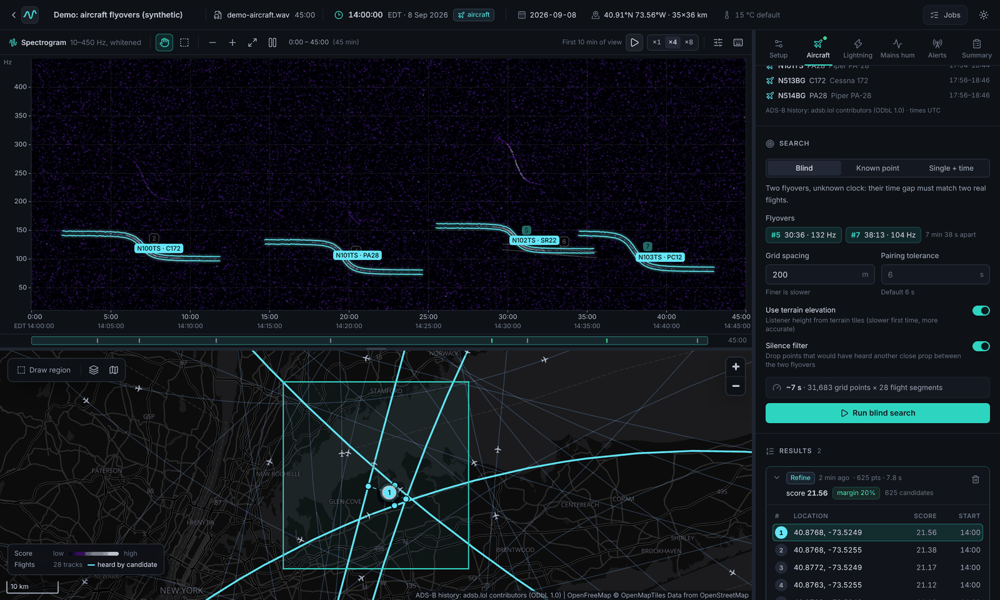
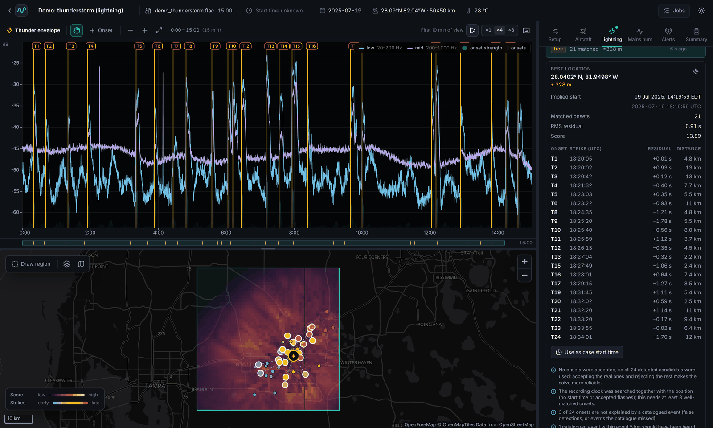
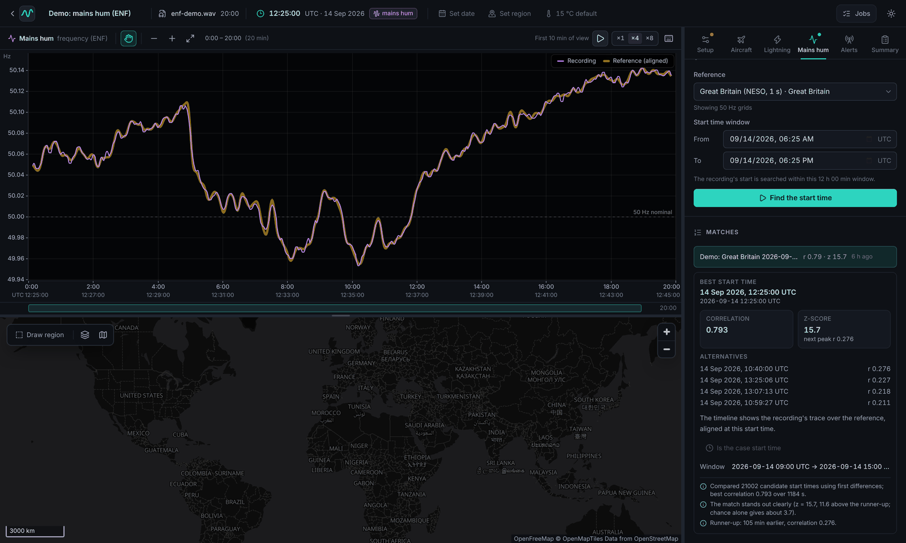

# TrackSound

A local web app for **acoustic geolocation**: work out where (and when) an audio or video
recording was made from faint sounds in it, matched against public records of events that
happened at known places and times.

It runs entirely on your machine: a small Python server plus a browser UI. Your recordings
never leave your computer; the only network traffic is downloading public reference data
(flight history, lightning, grid frequency, map tiles).



| Lightning and known events | Mains hum (ENF) |
|---|---|
|  |  |

*Screenshots from the built-in demo cases (`tracksound demo`). The mains-hum demo matches
real Great Britain grid data.*

## Evidence sources

| Source | What it listens for | Matched against | Gives |
|---|---|---|---|
| **Aircraft** | Propeller tones (60–400 Hz) and helicopter rotor tones (10–60 Hz) sweeping down in pitch as the aircraft passes (Doppler) | Historical ADS-B flight tracks ([adsb.lol](https://github.com/adsblol/globe_history_2026), free) | Location (tens of metres to about 2 km) and the recording's start time |
| **Lightning & known events** | Thunder onsets, blasts and booms, and flashes visible in video | NOAA GOES GLM lightning (free, Americas), USGS-listed quarry blasts, explosions and sonic booms, a CSV, or an event you enter | Location (km level with satellite lightning) and the start time; flash-to-bang range rings |
| **Mains hum (ENF)** | The 50/60 Hz hum's tiny frequency wobble | Power-grid frequency logs | The date and time, and which power grid |
| **Emergency alerts** | US EAS / NOAA Weather Radio data bursts (SAME headers) | FIPS county list; FEMA's IPAWS archive for cross-checks | Affected counties and the issue time, to the minute |

Sources help each other. For example, mains hum or an alert can supply the start time, and
a known start time lets the aircraft search work from a single flyover.

Where these ideas come from:

- The aircraft method comes from colsto's video
  ["I discovered a sound that leaks your exact location"](https://www.youtube.com/watch?v=UytYrhYLOKI)
  and is built on [mjshiggins/dopplertrack](https://github.com/mjshiggins/dopplertrack), an
  open, validated implementation.
- The other sources came out of a survey of audio geolocation techniques, which also ranks
  what to add next:
  [docs/research/audio-geolocation-techniques.md](docs/research/audio-geolocation-techniques.md).

**How well does it work?**

- On real flight-history days with synthetic audio at known points, it lands within about
  40–50 m ([docs/results/validation.md](docs/results/validation.md)).
- Real recordings are harder. Phones cut low frequencies, and jets give no clean tones.
- Other open tools found the tonal method fails on most arbitrary clips. Treat results as
  leads to check, and read the margins and runner-ups.

## Quick start

You need Python 3.12+ with [uv](https://docs.astral.sh/uv/), Node.js 22+, and ffmpeg.

1. Build the web UI (once, and after UI changes):

   ```bash
   cd frontend && npm install && npm run build
   ```

2. Optionally, create demo cases with synthetic recordings that need no downloads:

   ```bash
   cd backend && uv run tracksound demo      # aircraft, lightning, mains hum and alert demos
   ```

3. Start the app:

   ```bash
   cd backend && uv run tracksound serve --open
   ```

The app opens at http://127.0.0.1:8000. Data is kept in `~/.tracksound`; change that with
`--data DIR` or `TRACKSOUND_DATA`.

## Using it

1. **New case:** drop an audio or video file on the home page.
2. **Setup:** set the recording date (UTC day) and draw a search region on the map. Add the
   start time if you know it, and look up the air temperature.
3. **Aircraft:**
   1. Detect flyovers, using the Propeller or Helicopter preset, and accept the clear ones.
   2. Fetch that day's flights. This streams 2–4 GB once, takes a few minutes, and is
      cached.
   3. Run a blind search with two adjacent flyovers, then refine with any extra events.
4. **Lightning & events:**
   1. Detect thunder (and flashes, for video).
   2. Fetch GOES GLM strikes or USGS events, import a CSV, or enter a known event.
   3. Solve.
5. **Mains hum:** extract the ENF trace and match it against a grid-frequency reference to
   get the date and time.
6. **Alerts:** scan for emergency-alert bursts. A decoded header gives counties and an issue
   time.
7. **Summary:** compare what each source says, set the case start time from the best one,
   and export a JSON report.

## Development

- Backend: `cd backend && uv run pytest`. Slow and network tests are deselected; run them
  with `-m slow`.
- Frontend: `cd frontend && npm run dev`. That's the Vite dev server on :5173, proxying
  `/api` to the backend on :8000.
- API contract: [docs/API.md](docs/API.md). Live API docs are at `/api/docs` while the
  server runs.
- Plan and roadmap: [docs/PLAN.md](docs/PLAN.md).

## Data and attribution

- ADS-B history © adsb.lol contributors, [ODbL 1.0](http://opendatacommons.org/licenses/odbl/1.0/).
- Aircraft types: ICAO Doc 8643 via the OpenSky Network.
- Terrain: AWS Terrain Tiles.
- Lightning: NOAA GOES-R GLM. Seismic and explosion events: USGS ComCat.
- US counties: US Census Gazetteer (public domain). Emergency-alert cross-checks: FEMA OpenFEMA
  IPAWS archive.
- Air temperature: Open-Meteo (CC BY 4.0).
- Map data © OpenStreetMap contributors, tiles by OpenFreeMap.
- Grid frequency: see [docs/research/enf.md](docs/research/enf.md).

## Responsible use

This tool can reveal where a recording was made, including someone's home. Use it for
verification and research, and to check what your own recordings leak. Don't use it to
locate people without their consent. Results are estimates with real uncertainty. Read the
margins and runner-up candidates before trusting a single pin.
