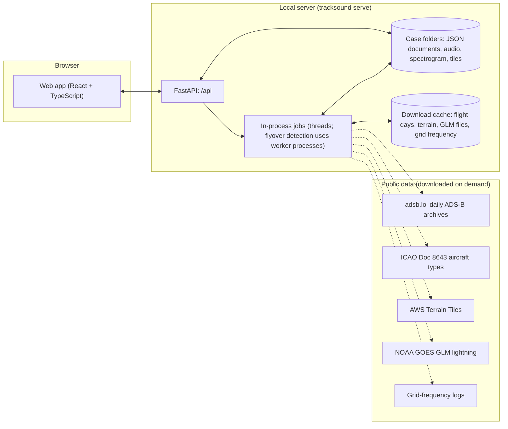

# TrackSound: project plan

Status: v0.2, 2026-11-04. Decided: local only (section 6). This is a living document;
update it as decisions are made and results come in.

## Contents

1. [What we're building](#1-what-were-building)
2. [How the method works](#2-how-the-method-works)
3. [What we need](#3-what-we-need)
4. [Scope](#4-scope)
5. [User flow](#5-user-flow)
6. [Architecture](#6-architecture)
7. [Designed for more sources](#7-designed-for-more-sources)
8. [Data sources and licences](#8-data-sources-and-licences)
9. [Tech stack](#9-tech-stack)
10. [Repository layout](#10-repository-layout)
11. [Relationship to dopplertrack](#11-relationship-to-dopplertrack)
12. [Roadmap](#12-roadmap)
13. [Validation](#13-validation)
14. [Risks and limitations](#14-risks-and-limitations)
15. [Responsible use](#15-responsible-use)
16. [Decisions](#16-decisions)
17. [References](#17-references)

---

## 1. What we're building

A web tool that estimates **where and when** a recording was made by matching
faint sounds in it against public records of events at known places and times.

- **Source 1 (v1): propeller aircraft.** Doppler curves of prop flyovers matched
  against historical ADS-B tracks.
- **Source 2 (later): lightning.** Thunder arrival delays matched against
  lightning-detection networks. See [research/lightning.md](research/lightning.md).
- Other sources can plug into the same core later (section 7).

Prior art we build on:

- **colsto's video**, ["I discovered a sound that leaks your exact location (and it's everywhere)"](https://www.youtube.com/watch?v=UytYrhYLOKI).
  Demonstrates the method. No code was released.
- **[mjshiggins/dopplertrack](https://github.com/mjshiggins/dopplertrack)**: an
  open Python reimplementation (MIT, PyPI `dopplertrack` v0.2.0). A CLI
  pipeline validated on two recordings with known answers:
  - Oyster Bay, NY: 43 m from truth.
  - A 12-hour eagle-cam stream in Florida: 592 m from truth, with 5 flyovers.

**What TrackSound adds on top of dopplertrack:**

- A UI: spectrogram viewer, curve inspection and editing, map of results and flights.
- A managed ADS-B data layer. dopplertrack streams a ~4 GB day archive for every query.
- Job handling for searches that take minutes, with progress, cancel and cost estimates.
- Results presented with their uncertainty (runner-ups, margins), not just a single pin.
- A pluggable core so lightning and other sources can be added and combined.

## 2. How the method works

A short version for anyone joining the project. dopplertrack's
[design spec](https://github.com/mjshiggins/dopplertrack/blob/main/docs/superpowers/specs/2026-11-03-doppler-geolocation-design.md)
has the full detail.

1. **The signal.** Prop aircraft emit a tone at the propeller blade-pass
   frequency f0, plus harmonics, usually 60–400 Hz. It is often buried under
   other sound, but it shows up clearly in a long-window spectrogram
   (2 s FFT window, 0.49 Hz bins) whitened so that steady tones like mains hum
   disappear.
2. **The physics.** A stationary listener hears
   `f(t) = f0 · c / (c + ṙ(tₑ))`, where ṙ is the aircraft's range rate at
   *emission* time tₑ and `t = tₑ + r(tₑ)/c`. The tone is higher on approach and
   lower as the aircraft recedes. The size of the drop gives the speed. How fast
   the drop happens gives the closest-approach (CPA) distance.
3. **The candidates.** Given the recording date and a rough region, take every
   prop flight that day from ADS-B history. For each point on a ground grid
   (200 m), compute when each flight passed closest and at what slant distance,
   using a terrain model for the listener's height.
4. **The unknown clock.** The recording's start time is usually unknown, so the
   search uses pairs of flyovers. If two flyovers are 918 s apart in the
   recording, only grid points that heard two real flights 918 s apart survive,
   with no other nearby prop flight in between (the "silence" filter). Each
   survivor's exact Doppler curves are then modelled from the real trajectories
   and scored against the spectrogram.
5. **Refinement.** A 50 m grid around the winner, plus any extra flyovers, all
   locked to the same clock. The output also gives the recording's absolute
   start time.

**Accuracy depends on geometry.** Low passes off to one side pin a location
sharply. High passes nearly overhead don't, because slant distance barely
changes as the listener moves. More flyovers give better results.

## 3. What we need

### People and skills

- **Signal processing and numerical Python.** Owns the aircraft source, the
  search, scoring, calibration and, later, lightning.
- **Frontend data visualisation.** WebGL spectrogram, MapLibre/deck.gl maps,
  linked views.
- **Backend and devops.** API, job queue, data ingestion, storage, deployment.

One person can cover several of these roles early on.

### Data (all free for v1; details in section 8)

- Historical ADS-B: adsb.lol daily archives (ODbL).
- Aircraft engine classes: ICAO Doc 8643 (OpenSky mirror), used to drop jets.
- Elevation: AWS Terrain Tiles.
- Air temperature (sets the speed of sound): Open-Meteo historical API.
- A basemap provider.

### Test recordings

- The two public reference recordings with known answers (section 13).
- **Our own ground-truth clips.** This is the most valuable dataset we can
  build. It needs a phone or recorder with GPS and an accurate clock, and
  30–60 minute outdoor recordings in varied places.

### Infrastructure

- **Each user's own computer.** TrackSound runs locally only (section 6). The machine
  needs Python 3.12+ with uv, Node.js 20+ (to build the UI) and ffmpeg.
- **Resources:** searches are CPU- and memory-bound, so more cores help. Two reference
  points:
  - dopplertrack's 100 × 150 km Oyster Bay search builds 86 M (point, flight) rows, about
    2.7 GB in memory, and took about 19 minutes on a laptop.
  - A 12-hour spectrogram is about 0.6 GB as float32.
  - Use smaller regions or coarser grids on smaller machines. The app shows a cost
    estimate before each search.
- **Disk:** a few hundred MB per cached flight day (props only), plus the cases
  themselves.

### Accounts

- None needed. adsb.lol, Terrain Tiles, NOAA GLM and OpenFreeMap need no key.
- Optional: `GITHUB_TOKEN` raises the GitHub API limit for flight downloads.
- Grid-frequency sources that need a key are described in [research/enf.md](research/enf.md).

## 4. Scope

### MVP (v1)

- Upload a recording (audio or any video container ffmpeg can read), up to
  12 hours.
- Enter the recording date (local date plus timezone, mapped to one or two UTC
  days) and draw a search region on a map.
- Interactive spectrogram (40–450 Hz) with zoom and pan:
  - Detected flyovers are listed and overlaid on it.
  - Users can accept, reject or edit each flyover (window, band, harmonics).
  - Users can draw a box around a sweep to fit a curve by hand.
- Search modes:
  - **Blind:** two or more events, unknown clock.
  - **Known point:** score one location the user chooses, to check a claim.
  - **Single event, known time:** one flyover, absolute time known.
- Results:
  - A heat map on the map and a ranked list of candidates.
  - Matched flights for each candidate (registration, type, track drawn on the map).
  - Modelled curves overlaid on the spectrogram.
  - The score margin over the runner-up.
  - Refinement with extra events.
  - The estimated recording start time.
- Export: JSON/CSV and PNG. A formatted report comes later.
- Self-hostable with a single `docker compose up`.

### Not in v1

- Accounts and hosting: TrackSound is local only (section 6).
- Importing from URLs (YouTube etc.), because of terms-of-service and legal
  questions. File upload only.
- Live streams or real-time processing.
- Searching across multiple days or unknown dates for aircraft. ENF matching and
  emergency-alert headers can supply the date and time when it is unknown.

Beyond the original v1 scope, the first version also includes lightning, mains hum
(ENF) and emergency-alert (EAS/SAME) sources (section 12).

## 5. User flow

1. **New case, then upload.** The server decodes the file and builds the
   spectrogram, with a progress bar.
2. **Case setup.**
   - Required: date and timezone, and a region (draw a box, or pick a place and
     radius).
   - Optional: known start time, and air temperature (filled from the weather
     archive by default).
3. **Events.**
   - "Detect flyovers" scans the whole recording and lists candidates by score.
   - Click a candidate to inspect its fitted curve, then accept it, reject it,
     or adjust and refit it.
   - Or draw a box around a sweep and fit it.
4. **Search.**
   - The tool suggests the best anchor pair (strong, well-separated events).
   - Pick a mode and grid spacing, and see a cost estimate (grid points ×
     flights) before running.
   - Live progress while it runs, and a cancel button.
5. **Results.**
   - **Map:** heat map, the top N candidates, and the matched flight tracks with
     a time slider.
   - **Evidence panel:** modelled curves on the spectrogram for each event,
     CPA distances, per-event scores, and the margin to the next flight pair.
   - "Refine" runs a 50 m grid with any extra accepted events.
   - Click anywhere on the map to run a known-point check there.
6. **Export or share.**

## 6. Architecture

**Decision (2026-11-04): TrackSound runs locally only.** It is a Python server on the
user's own machine plus a browser UI. There are no accounts, no hosted service, no
database server and no job queue. That keeps recordings private and keeps the tool free
to run. This section describes what is built.



### Web app (frontend, `frontend/`)

- React + TypeScript + Vite, TanStack Query for server state, and MapLibre GL for maps.
  Basemaps are OpenFreeMap vector tiles, with Esri imagery as an option; neither needs an
  API key.
- **Case workspace:** a timeline pane and a map pane, plus a sidebar with Setup, Aircraft,
  Lightning, Mains hum and Summary tabs.
  - The timeline shows the spectrogram, the thunder envelope or the ENF trace, all on one
    shared time axis.
- `npm run build` writes `frontend/dist`, and the Python server serves it at `/`.
  Development details are in `frontend/README.md`.

### Local server (backend, `backend/src/tracksound/`)

- **API:** FastAPI under `/api`. The contract is [API.md](API.md), and interactive docs
  are at `/api/docs`.
- **Storage:** one folder per case under `~/.tracksound/cases/<id>/` (or `--data DIR`),
  with JSON documents written atomically (`store.py`). Each source keeps its files in its
  own subfolder (`aircraft/`, `lightning/`, `enf/`).
- **Jobs:** long work (decoding, detection, downloads, searches) runs in background threads
  with progress and cooperative cancellation (`jobs.py`). The UI polls `/api/jobs/{id}`.
  Jobs are not persisted: a job's output is written into the case folder before it
  finishes.
- **Uploads:** each upload is decoded once with ffmpeg into a mono 4 kHz float32 WAV that
  every source reads. The original is kept for video frames.
- **Spectrogram:** the 40–450 Hz spectrogram (dopplertrack's STFT and whitening) is used
  for scoring. A uint8 tile pyramid is used for display:
  - Tiles are 1024 frames wide.
  - Zoomed-out levels use max-pooling so faint lines survive.
  - Sizes: 1 hour is 14,400 frames × 840 bins; 12 hours is 172,800 frames.
- **Flights** (`sources/aircraft/flights.py`):
  - One UTC day of adsb.lol history is streamed once (about 3.9 GB, minutes) and filtered
    to props touching the region. The result is cached per day and region, and reused by
    any case whose region it contains.
  - The GitHub API is only used to list the archive's parts. When it is rate-limited or
    blocked, the part names (`.tar.aa`, `.tar.ab`, ...) are probed directly. Set
    `GITHUB_TOKEN` to raise the limit.
- **Searches** (`sources/aircraft/search.py`): dopplertrack's physics, filters and scoring,
  re-expressed as loops that report progress, can be cancelled, and keep what the UI needs:
  - the flights each candidate heard;
  - the clock each candidate implies, i.e. the recording's start time;
  - the modelled curves to draw over the spectrogram.
- **Terrain:** AWS Terrain Tiles via dopplertrack, cached. Searches fall back to sea level
  when offline.
- **Speed of sound:** taken from the case temperature (default 15 °C). Fetching the
  temperature automatically from a weather archive is a later addition.
- **Demo cases:** `tracksound demo` builds synthetic cases (aircraft, lightning, ENF) whose
  true answers are known and that need no downloads.

### Privacy

- Recordings stay on the user's machine. The server listens on 127.0.0.1 by default.
- Network traffic is limited to downloading public reference data and map tiles.

## 7. Designed for more sources

The aircraft method is one instance of a general pattern:

> A recording contains acoustic signatures of events. A public catalogue records
> where and when those events happened. A propagation model predicts what a
> listener at point *x* would have heard, and when. Search over *x* and the
> recording's clock offset for the best match.

Core interfaces (Python, in `tracksound.core`):

| Interface | Aircraft (v1) | Lightning (later) |
|---|---|---|
| `Detector`: finds observations in the recording | Doppler-curve detection and fitting (dopplertrack `detect` / `fit`) | Thunder-onset detection; flash frames in video; possibly sferic clicks |
| `Catalogue`: events for a time range and region | Prop-aircraft ADS-B tracks | Lightning strokes or flashes (GLM, MTG-LI, ground networks) |
| `ForwardModel`: what point *x* would observe | Emission-time Doppler curve from the real trajectory | Arrival time = strike time + distance / c |
| `Scorer`: how well the observations fit (*x*, clock) | Brightness under the modelled curve, multi-event locked to one clock | Robust arrival-time residuals after association |

**Shared core:**

- The candidate grid and terrain.
- The clock model: an unknown offset, and later possibly drift.
- Search orchestration and tiling.
- Combining results from different sources.
- The map and evidence UI. Event and evidence panels are per-source components,
  keyed by `source_type`.

**Combining sources.** Each source produces a score map over the same grid and
clock offsets. The maps are combined by summing calibrated log-likelihoods.

- dopplertrack's scores are brightness sums, not likelihoods, so calibration is
  a research item. One approach: convert each score to a z-score against a null
  distribution built from decoy flights or time-shifted catalogues.
- Do this once a second source exists. It shouldn't block v1.

**The clock is shared, which is where sources help each other.**

- Lightning can give a recording's absolute time: a flash visible in video, or
  thunder matched to strikes. With a known time, the aircraft search switches to
  the cheaper single-event mode, which works with just one flyover.
- Aircraft can fix the clock for lightning in the same way.

**Interface timing.** Keep the interfaces thin in v1 and wrap dopplertrack
behind them. Don't over-generalise before the second source is real. Refactor
properly in M5.

## 8. Data sources and licences

| Need | Source | Cost | Licence / terms | Notes |
|---|---|---|---|---|
| ADS-B history | [adsb.lol `globe_history_YYYY`](https://github.com/adsblol/globe_history_2026) GitHub releases | Free | [ODbL 1.0](http://opendatacommons.org/licenses/odbl/1.0/) | About 4 GB per day; readsb `trace_full` JSON |
| ADS-B (alternative) | OpenSky Network historical database | Free for research | Application required, non-commercial | Fallback and cross-check |
| Engine class | ICAO Doc 8643 via OpenSky's mirror | Free | | Used to drop jets; unknown types are kept |
| Elevation | AWS Terrain Tiles (Terrarium) | Free | Attribution to the underlying sources | Zoom 11–12 |
| Temperature | Open-Meteo historical API | Free (non-commercial) | CC BY 4.0 | Speed of sound |
| Basemap | Protomaps (self-hosted) or MapTiler / Stadia | Free tier or self-host | OSM data under ODbL, with attribution | |
| Lightning (later) | GOES GLM, MTG-LI, Blitzortung, commercial networks | Varies | Varies | See [research/lightning.md](research/lightning.md) |

**ODbL obligations (adsb.lol):**

- Results we show are "produced works", so the UI and exports need an
  attribution notice.
- Our filtered flight store is a derived database. If we ever publish it or
  offer it publicly, it must be released under ODbL too.

## 9. Tech stack

- **Backend:** Python ≥ 3.12, uv, FastAPI, Pydantic, and NumPy/SciPy/pandas via
  dopplertrack (pinned at 0.2.0). Also h5py (GOES GLM NetCDF), soundfile and ffmpeg.
- **Storage:** plain files (JSON documents, NPZ arrays) in a data folder.
  - No database server; jobs run in-process.
  - If many cases or concurrent users ever matter, SQLite is the next step.
- **Frontend:** TypeScript, React, Vite, TanStack Query and MapLibre GL JS.
  - Basemaps are OpenFreeMap vectors, with Esri imagery as an option.
  - Playwright is used for browser checks.
- **CI:** GitHub Actions (`.github/workflows/ci.yml`) runs the backend tests and the
  frontend typecheck and build.
- **Compute:** CPU and NumPy.
  - Flyover detection and flight-archive parsing use worker processes.
  - The hot paths (CPA table, sweep scoring) are candidates for Numba or JAX later.

## 10. Repository layout

```
TrackSound/
├── backend/
│   ├── pyproject.toml, uv.lock
│   ├── src/tracksound/
│   │   ├── app.py, cli.py      # FastAPI app; `tracksound serve | demo`
│   │   ├── store.py, jobs.py   # case folders (JSON); in-process jobs with progress/cancel
│   │   ├── audio_io.py         # ffmpeg decode to the standard 4 kHz mono WAV
│   │   ├── spectrogram.py      # whitened spectrogram + display tile pyramid
│   │   ├── demo.py             # synthetic demo cases
│   │   ├── api/                # routers: cases, jobs, aircraft, lightning, enf, report
│   │   ├── sources/
│   │   │   ├── aircraft/       # dopplertrack wrapper: flights cache, searches, synthetic worlds
│   │   │   ├── lightning/      # thunder/flash detection, GLM + CSV catalogues, solver
│   │   │   └── enf/            # mains-hum extraction, grid references, matching
│   │   └── data/               # bundled geodata (countries by mains frequency)
│   └── tests/
├── frontend/                   # React + TypeScript app, built to frontend/dist
├── docs/
│   ├── PLAN.md, API.md
│   └── research/               # lightning.md, enf.md, audio-geolocation-techniques.md
└── .github/workflows/ci.yml
```

## 11. Relationship to dopplertrack

**Recommendation:** depend on the PyPI package with an exact version pin, wrap it
behind our `sources/aircraft` interfaces, and contribute fixes upstream.

- **Why not fork or port:**
  - Its physics and search are validated and documented, and MIT-licensed.
  - Rewriting them, for example in TypeScript, would give up that validation for
    little gain, because the heavy compute has to run on a server anyway.
- **When to fork:** only if we need internal changes faster than upstream
  accepts them.
- **Expect API churn.** It's very new (v0.2.0, November 2026), so the pin and our
  wrapper layer matter.

**What our wrapper adds (done in `sources/aircraft/`).** Each of these could go upstream as a
pull request:

- Progress and cancellation for the CPA table, the scoring loops and refine.
- Modelled curves per candidate, for drawing on the spectrogram, and the implied start time.
- Single-event parents for refine.
- A parallel flight-archive parser (worker processes), and a download that works when the
  GitHub API is rate-limited (part names are probed directly).
- Traces come from our per-day cache, not dopplertrack's `fetch`.

## 12. Roadmap

Status on 2026-11-04. Milestones M0–M3 of the original plan are done, in their
local-only form; the hosting parts of M4 were dropped (section 6).

### Done

- **Foundations:** repo layout, CI, local server, JSON case store, in-process jobs, demo
  cases.
- **Flight data:** adsb.lol day download with a per-day cache, parsed in parallel
  (about 2 minutes per day). Props and helicopters are kept, using Doc 8643.
- **Recordings and events:**
  - Upload, a 10–450 Hz spectrogram and a tiled viewer.
  - Flyover detection with quality labels, manual box fitting, and curve overlays.
  - Helicopter rotor presets.
- **Searches:** blind, known-point and single-event, plus refine with extra events.
  They run with progress, cancellation and a cost estimate, show the modelled curves on
  the spectrogram, and give the implied start time. Margins and runner-ups are shown.
- **Validation on real ADS-B days** ([results/validation.md](results/validation.md)):
  - Oyster Bay: 39 m after refining.
  - Eagle cam: 51 m.
  - The audio was synthetic, so this is not yet a test on real microphones.
- **Lightning:** thunder onsets, video flashes, GOES GLM and CSV catalogues, and a solver
  that searches position and clock ([research/lightning.md](research/lightning.md)).
  - Being extended to any known-time sharp event: USGS-listed blasts and sonic booms,
    and user-entered events.
- **Mains hum (ENF):**
  - Hum extraction, 50/60 Hz detection and a country map.
  - Grid-frequency references, built in and imported.
  - Start-time matching ([research/enf.md](research/enf.md)).
- **Emergency alerts (EAS/SAME):** decoding US alert headers gives counties and an issue
  time ([research/alerts.md](research/alerts.md)).
- **Research survey** of other techniques
  ([research/audio-geolocation-techniques.md](research/audio-geolocation-techniques.md)).

### Next

1. **Our own ground-truth recordings.** This is the most important next step.
   - Record 20+ clips: 30–60 minutes, outdoors, with GPS position and an accurate clock.
     Use phones and dedicated recorders, near and far from airports.
   - Measure the real success rate and publish failures as well as successes. Open
     tools that tried this found the tonal method fails on most arbitrary clips (survey,
     section 3.1).
2. **Jets via the ground-reflection delay** (survey 3.3).
   - Jets dominate traffic near airports and give broadband noise, not tones.
   - Track the cepstral peak of the direct/reflected path difference and match it to
     ADS-B tracks with jets kept.
   - This needs the original sample rate, not the 4 kHz copy.
3. **Calibrated scores and evidence fusion.**
   - Turn each source's score into a likelihood: z-scores against decoy flights,
     strikes or time shifts.
   - Combine sources on one grid and one clock.
   - The Summary tab currently shows the sources side by side.
4. **More clock anchors** (survey 5.1): a siren-test rules table, and time signals.
5. **Spikes from the survey:**
   - ships vs AIS (US and Danish archives are free);
   - bell-tower fingerprints vs Dove's Guide;
   - trains vs open train-movement data.
6. **Packaging:**
   - ship the built UI inside the Python package, so users don't need Node;
   - a one-command installer;
   - optional in-browser spectrogram for privacy.
7. **Performance:** split large searches into tiles across processes, and profile the
   CPA and scoring hot paths (Numba or JAX).

## 13. Validation

- **Unit tests:** dopplertrack already tests the physics. We test our wrappers,
  flight-store queries, API and jobs.
- **Synthetic end-to-end tests:**
  1. Take a real ADS-B track and a known ground point, and render the tones the
     forward model predicts, with noise, into a fake recording.
  2. Run the full pipeline and check the error.
  
  These are cheap enough to run on every PR.
- **Reference recordings with known answers** (nightly, because they cost
  minutes of CPU and a data download):
  - Oyster Bay, NY, 2026-09-08: [youtu.be/4CxVxuMVkMc](https://youtu.be/4CxVxuMVkMc), true location
    40.876466, -73.524951.
  - Southwest Florida Eagle Cam, 2024-12-28, 12 h: [youtu.be/zs2o5Rhlp5w](https://youtu.be/zs2o5Rhlp5w),
    nest at 26.702359, -81.847766.
- **Our own ground-truth set:**
  - Record 30–60 minute outdoor clips with GPS position and an accurate start
    time.
  - Cover places near and far from airports, phones and dedicated microphones,
    and different apps and codecs.
  - Aim for 20+ clips across varied geography.
- **What we report:** the error distribution, not only the best cases. Track the
  "right flight pair ranked first" rate and the score margin.
- **Results so far:** see [results/validation.md](results/validation.md). These are real
  ADS-B days with synthetic audio at the two reference points (39 m and 51 m), plus a
  failure caused by the silence filter in a busy sky, which is now handled
  automatically.
- **Automated tests:** `backend/tests` covers the API, the aircraft pipeline on a
  synthetic world, helicopters, flight-archive parsing, lightning, ENF and alerts.
  CI runs it on every push.

## 14. Risks and limitations

| Risk | Impact | Mitigation |
|---|---|---|
| ADS-B coverage gaps (rural, low altitude, aircraft without ADS-B Out, noisier MLAT-only positions) | No match, or a wrong match | Show the flights that *are* known for the region and time; offer OpenSky as a second source |
| Recording quality: phone high-pass filters, noise suppression, AGC, wind, lossy codecs | Faint or missing curves | Detection-quality indicator; guidance on what works; test across devices and codecs |
| Edited, sped-up or stitched clips | The single-clock assumption breaks | Warn on discontinuities; per-segment analysis later |
| Thin margins (4.9 % and 2.5 % on the reference recordings) | A wrong flight pair can look right | Always show runner-ups and margins; encourage 3+ events; calibrated confidence later |
| Busy skies (flight schools, airports) | Many coincidental flight pairs; the "silence" filter rejects the true point when other flyovers lie between the chosen events | Automatic: the filter is switched off when other flyovers were detected in between; the UI suggests adjacent events |
| Real clips often show no tonal flyovers (survey 3.1: open tools found most arbitrary clips fail) | No result at all | Publish failure rates; add jets via ground reflection; combine with ENF, alerts and lightning |
| Poor geometry (high or overhead passes) | km-level uncertainty | Show uncertainty spread on the map; suggest extra events |
| Compute cost: blind searches took 8–19 min on a laptop for 100–130 km regions, scaling with area × flights | Slow on small machines | Cost estimate before running; start with a smaller region; tiled parallel search later |
| Dependence on adsb.lol releases on GitHub | Availability, bandwidth, policy | Ingest each day once and cache; keep `FlightSource` pluggable |
| dopplertrack API churn | Breakage on upgrade | Pin the version, keep a wrapper layer, golden tests |
| Date must be known | No search without it | v1 needs a date; multi-day search is a later feature |

## 15. Responsible use

This tool reveals where a recording was made, which can be someone's home. The
same capability is useful for verification (journalists and researchers
checking where footage was really shot) and for self-audit (checking whether
your own recordings leak your location). Design choices:

- **Private by default.** Cases are visible only to their creator, and there is
  no public gallery.
- **Short retention.** Raw uploads are deleted once processed, and anything can
  be deleted on request.
- **Terms of use** that prohibit locating private individuals without consent,
  plus abuse handling on any hosted instance.
- **Honest uncertainty.** Never present a single pin as certain. Wrong answers
  can lead to wrong accusations.
- **A "privacy check" framing** for individuals: upload your own clip and see
  whether it leaks your location. Later, a scrub tool could notch the detected
  aircraft tones out of the audio.

## 16. Decisions

| # | Decision | Status | Why |
|---|---|---|---|
| 1 | Use dopplertrack as a dependency, fork it, or port it | **Decided:** pinned dependency (0.2.0); our additions live in a wrapper (section 11) | Validated physics; MIT; avoids divergence |
| 2 | Where audio is processed | **Decided:** on the user's machine (local server) | Local only: nothing leaves the computer |
| 3 | Hosting model | **Decided:** local only, no hosted service | Privacy, cost, abuse risk |
| 4 | Frontend framework | **Decided:** React + TypeScript + MapLibre, with no deck.gl | Fewer dependencies; MapLibre layers were enough |
| 5 | Job queue | **Decided:** in-process threads | One user per server; no Redis needed |
| 6 | Flight store | **Decided for now:** per-day, per-region NPZ cache of dopplertrack traces | Simple and fast enough; GeoParquet + DuckDB if regions get large |
| 7 | Project licence | **Open** (MIT or Apache-2.0 for code) | ODbL obligations apply to adsb.lol data regardless |
| 8 | URL import (YouTube etc.) | **Not planned** | Terms of service and legal risk |
| 9 | Gunshot ranging and multi-recording TDOA | **Deferred** until a responsible-use review | They locate a source rather than the recording, and are sensitive |

## 17. References

- colsto, ["I discovered a sound that leaks your exact location (and it's everywhere)"](https://www.youtube.com/watch?v=UytYrhYLOKI), YouTube.
- [mjshiggins/dopplertrack](https://github.com/mjshiggins/dopplertrack) and its
  [design spec](https://github.com/mjshiggins/dopplertrack/blob/main/docs/superpowers/specs/2026-11-03-doppler-geolocation-design.md).
- [adsb.lol globe_history](https://github.com/adsblol/globe_history_2026) and the
  [readsb trace JSON format](https://github.com/wiedehopf/readsb/blob/dev/README-json.md#trace-jsons).
- [AWS Terrain Tiles](https://registry.opendata.aws/terrain-tiles/).
- [Open-Meteo historical weather API](https://open-meteo.com/en/docs/historical-weather-api).
