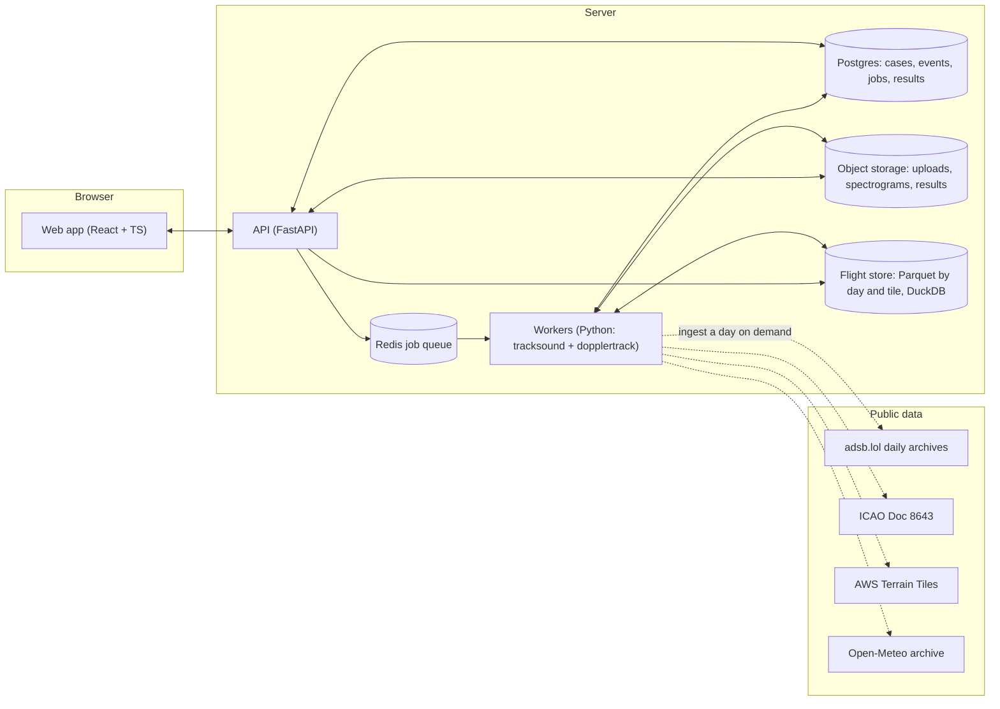

# TrackSound: project plan

Status: draft v0.1, 2026-11-04. This is a living document. Update it as
decisions are made and spikes come back with numbers.

## Contents

1. [What we're building](#1-what-were-building)
2. [How the method works](#2-how-the-method-works)
3. [What we need](#3-what-we-need)
4. [Scope](#4-scope)
5. [User flow](#5-user-flow)
6. [Architecture](#6-architecture)
7. [Designed for more sources](#7-designed-for-more-sources)
8. [Data sources and licences](#8-data-sources-and-licences)
9. [Tech stack](#9-tech-stack)
10. [Repository layout](#10-repository-layout)
11. [Relationship to dopplertrack](#11-relationship-to-dopplertrack)
12. [Roadmap](#12-roadmap)
13. [Validation](#13-validation)
14. [Risks and limitations](#14-risks-and-limitations)
15. [Responsible use](#15-responsible-use)
16. [Open decisions](#16-open-decisions)
17. [References](#17-references)

---

## 1. What we're building

A web tool that estimates **where and when** a recording was made by matching
faint sounds in it against public records of events at known places and times.

- **Source 1 (v1): propeller aircraft.** Doppler curves of prop flyovers matched
  against historical ADS-B tracks.
- **Source 2 (later): lightning.** Thunder arrival delays matched against
  lightning-detection networks. See [research/lightning.md](research/lightning.md).
- Other sources can plug into the same core later (section 7).

Prior art we build on:

- **colsto's video**, ["I discovered a sound that leaks your exact location (and it's everywhere)"](https://www.youtube.com/watch?v=UytYrhYLOKI).
  Demonstrates the method. No code was released.
- **[mjshiggins/dopplertrack](https://github.com/mjshiggins/dopplertrack)**: an
  open Python reimplementation (MIT, PyPI `dopplertrack` v0.2.0). A CLI
  pipeline validated on two recordings with known answers:
  - Oyster Bay, NY: 43 m from truth.
  - A 12-hour eagle-cam stream in Florida: 592 m from truth, with 5 flyovers.

**What TrackSound adds on top of dopplertrack:**

- A UI: spectrogram viewer, curve inspection and editing, map of results and flights.
- A managed ADS-B data layer. dopplertrack streams a ~4 GB day archive for every query.
- Job handling for searches that take minutes, with progress, cancel and cost estimates.
- Results presented with their uncertainty (runner-ups, margins), not just a single pin.
- A pluggable core so lightning and other sources can be added and combined.

## 2. How the method works

A short version for anyone joining the project. dopplertrack's
[design spec](https://github.com/mjshiggins/dopplertrack/blob/main/docs/superpowers/specs/2026-11-03-doppler-geolocation-design.md)
has the full detail.

1. **The signal.** Prop aircraft emit a tone at the propeller blade-pass
   frequency f0, plus harmonics, usually 60–400 Hz. It is often buried under
   other sound, but it shows up clearly in a long-window spectrogram
   (2 s FFT window, 0.49 Hz bins) whitened so that steady tones like mains hum
   disappear.
2. **The physics.** A stationary listener hears
   `f(t) = f0 · c / (c + ṙ(tₑ))`, where ṙ is the aircraft's range rate at
   *emission* time tₑ and `t = tₑ + r(tₑ)/c`. The tone is higher on approach and
   lower as the aircraft recedes. The size of the drop gives the speed. How fast
   the drop happens gives the closest-approach (CPA) distance.
3. **The candidates.** Given the recording date and a rough region, take every
   prop flight that day from ADS-B history. For each point on a ground grid
   (200 m), compute when each flight passed closest and at what slant distance,
   using a terrain model for the listener's height.
4. **The unknown clock.** The recording's start time is usually unknown, so the
   search uses pairs of flyovers. If two flyovers are 918 s apart in the
   recording, only grid points that heard two real flights 918 s apart survive,
   with no other nearby prop flight in between (the "silence" filter). Each
   survivor's exact Doppler curves are then modelled from the real trajectories
   and scored against the spectrogram.
5. **Refinement.** A 50 m grid around the winner, plus any extra flyovers, all
   locked to the same clock. The output also gives the recording's absolute
   start time.

**Accuracy depends on geometry.** Low passes off to one side pin a location
sharply. High passes nearly overhead don't, because slant distance barely
changes as the listener moves. More flyovers give better results.

## 3. What we need

### People and skills

- **Signal processing and numerical Python.** Owns the aircraft source, the
  search, scoring, calibration and, later, lightning.
- **Frontend data visualisation.** WebGL spectrogram, MapLibre/deck.gl maps,
  linked views.
- **Backend and devops.** API, job queue, data ingestion, storage, deployment.

One person can cover several of these roles early on.

### Data (all free for v1; details in section 8)

- Historical ADS-B: adsb.lol daily archives (ODbL).
- Aircraft engine classes: ICAO Doc 8643 (OpenSky mirror), used to drop jets.
- Elevation: AWS Terrain Tiles.
- Air temperature (sets the speed of sound): Open-Meteo historical API.
- A basemap provider.

### Test recordings

- The two public reference recordings with known answers (section 13).
- **Our own ground-truth clips.** This is the most valuable dataset we can
  build. It needs a phone or recorder with GPS and an accurate clock, and
  30–60 minute outdoor recordings in varied places.

### Infrastructure

- **Development:** laptops plus Docker Compose.
- **Hosted (later):** one CPU-heavy machine to start (≥ 8 cores, ≥ 32 GB RAM).
  Searches are CPU- and memory-bound. Two reference points:
  - The Oyster Bay blind search builds 86 M (point, flight) rows, about 2.7 GB
    in memory.
  - A 12-hour spectrogram is about 0.6 GB as float32.
- **Storage:** disk for the filtered flight store (size to be measured in the M0
  spike), object storage for uploads, spectrograms and results, and a domain.

### Accounts

- None for v1. adsb.lol, Terrain Tiles and Open-Meteo need no key.
- A map-tile API key if we use a hosted basemap.
- A EUMETSAT account for lightning, later.

## 4. Scope

### MVP (v1)

- Upload a recording (audio or any video container ffmpeg can read), up to
  12 hours.
- Enter the recording date (local date plus timezone, mapped to one or two UTC
  days) and draw a search region on a map.
- Interactive spectrogram (40–450 Hz) with zoom and pan:
  - Detected flyovers are listed and overlaid on it.
  - Users can accept, reject or edit each flyover (window, band, harmonics).
  - Users can draw a box around a sweep to fit a curve by hand.
- Search modes:
  - **Blind:** two or more events, unknown clock.
  - **Known point:** score one location the user chooses, to check a claim.
  - **Single event, known time:** one flyover, absolute time known.
- Results:
  - A heat map on the map and a ranked list of candidates.
  - Matched flights for each candidate (registration, type, track drawn on the map).
  - Modelled curves overlaid on the spectrogram.
  - The score margin over the runner-up.
  - Refinement with extra events.
  - The estimated recording start time.
- Export: JSON/CSV and PNG. A formatted report comes later.
- Self-hostable with a single `docker compose up`.

### Not in v1

- Accounts and multi-user hosting (planned for M4).
- Importing from URLs (YouTube etc.), because of terms-of-service and legal
  questions. File upload only.
- Lightning and other sources. We design for them but don't build them.
- Live streams or real-time processing.
- Searching across multiple days or unknown dates.

## 5. User flow

1. **New case, then upload.** The server decodes the file and builds the
   spectrogram, with a progress bar.
2. **Case setup.**
   - Required: date and timezone, and a region (draw a box, or pick a place and
     radius).
   - Optional: known start time, and air temperature (filled from the weather
     archive by default).
3. **Events.**
   - "Detect flyovers" scans the whole recording and lists candidates by score.
   - Click a candidate to inspect its fitted curve, then accept it, reject it,
     or adjust and refit it.
   - Or draw a box around a sweep and fit it.
4. **Search.**
   - The tool suggests the best anchor pair (strong, well-separated events).
   - Pick a mode and grid spacing, and see a cost estimate (grid points ×
     flights) before running.
   - Live progress while it runs, and a cancel button.
5. **Results.**
   - **Map:** heat map, the top N candidates, and the matched flight tracks with
     a time slider.
   - **Evidence panel:** modelled curves on the spectrogram for each event,
     CPA distances, per-event scores, and the margin to the next flight pair.
   - "Refine" runs a 50 m grid with any extra accepted events.
   - Click anywhere on the map to run a known-point check there.
6. **Export or share.**

## 6. Architecture



### Web app (frontend)

- **Framework:** React + TypeScript + Vite. TanStack Query for server state, and
  a TypeScript client generated from the API's OpenAPI schema.
- **Map:** MapLibre GL JS with deck.gl layers for the heat map, candidate points
  and flight tracks.
  - Basemap: self-hosted Protomaps PMTiles, or a hosted provider (MapTiler,
    Stadia).
  - Not `tile.openstreetmap.org`, whose usage policy forbids this kind of load.
- **Spectrogram viewer:**
  - WebGL rendering of quantised tiles, with colormap and contrast controls.
  - A canvas overlay layer for detected curves, harmonics and per-candidate
    modelled curves.
  - A cursor linked to the map's flight time slider.
- **Nice-to-have:** play back a selected window pitch-shifted up a few octaves,
  so people can *hear* the sweep.

### API (FastAPI)

REST, plus Server-Sent Events for job progress. Draft endpoints:

| Method | Path | Purpose |
|---|---|---|
| POST | `/cases` | Create a case (date, timezone, region, temperature) |
| POST | `/cases/{id}/recording` | Upload a recording (multipart; resumable uploads later) |
| GET | `/recordings/{id}/spectrogram/{z}/{x}` | One spectrogram tile |
| POST | `/recordings/{id}/detect` | Start flyover detection |
| GET, POST, PATCH | `/cases/{id}/events` | List, add (manual fit), accept/reject/edit |
| GET | `/flights?date=&bbox=` | Prop flights for the map (ingests the day on demand) |
| POST | `/cases/{id}/searches` | Start a search (mode, events, spacing) |
| GET | `/searches/{id}` | Status and results summary |
| GET | `/searches/{id}/candidates/{rank}` | Evidence: matched flights, modelled curves, scores |
| POST | `/searches/{id}/refine` | Fine grid plus extra events |
| GET | `/jobs/{id}/stream` | Progress (SSE) |

### Data model (draft)

- **Case:** name, UTC day(s), timezone, region bbox, temperature, notes.
- **Recording:** case, filename, duration, sample rate, storage keys (raw file,
  spectrogram, tiles).
- **Event:** case, `source_type` (`aircraft` for now), status (detected,
  accepted, rejected, manual), window, band, harmonics, and the fitted
  parameters as JSON (dopplertrack's `EventFit`: f0, v, d, t_cpa, ...).
- **Search:** case, mode, config JSON, status, timings, cost estimate.
- **Candidate:** search, rank, lat/lon, total score, per-event components
  (flight, time shift, score) as JSON, estimated start time in UTC.
- **Job:** type, status, progress, error, timestamps.

`source_type` plus a JSON parameter column keeps the schema the same when
lightning arrives.

### Workers

- They share a Python package with the API and run as separate processes,
  pulling jobs from Redis.
- **Job types:** `build_spectrogram`, `detect_events`, `fit_event`,
  `ingest_adsb_day`, `search` (blind, known-point or single), `refine`.
- Long jobs report progress and can be cancelled.
- Results go to object storage, with summary rows in Postgres.
- (point, flight) CPA tables are cached, keyed by day, region, spacing and trace
  set. dopplertrack already fingerprints them for this.

### Flight data service

**The problem.** dopplertrack's `fetch-day` streams a whole adsb.lol day archive
(about 4 GB) from GitHub releases for every query. That's fine for a one-off
CLI run, but not for a web tool.

**The plan:**

1. `ingest_adsb_day(date)` streams the archive **once**. It keeps prop and
   unknown-type aircraft, using Doc 8643 engine classes, and writes the raw
   track points to GeoParquet partitioned by `date / tile` (1°×1° cells or H3
   resolution 3).
2. Region queries then read only the tiles that touch the region, using DuckDB.
   That takes seconds, not minutes, and there's no database server to run.
3. Days are ingested on demand and cached, with optional prefetch for recent
   days. Old days are evicted when storage fills up.
4. Ingestion sits behind a `FlightSource` interface, so OpenSky or another
   provider can be added as a fallback or cross-check.

**Measure in M0:** ingest time per day, stored size per day after filtering,
and peak memory.

### Terrain and weather

- **Terrain:** AWS Terrain Tiles (Terrarium), cached on disk or in object
  storage. dopplertrack's `Terrain` class already handles this.
- **Temperature:** Open-Meteo historical 2 m temperature at the region centre and
  recording time, which sets the speed of sound (dopplertrack defaults to
  15 °C). Users can override it. Wind is a later refinement.

### Where the audio is processed (privacy)

- **v1: on the server.** Upload the file, decode it with ffmpeg, and build the
  spectrogram there. This is the fastest path, since it uses dopplertrack
  unchanged.
- **Later: in the browser (privacy mode).**
  - Decode the file and compute the 40–450 Hz magnitude spectrogram in the
    browser (WebAudio plus FFT in a Web Worker or WASM). Upload only that.
  - With 2 s windows, no phase and that band, the spectrogram is very unlikely
    to contain intelligible speech, so the raw recording never leaves the
    user's machine. We should verify this claim before advertising it.
  - This needs numerical parity with dopplertrack's STFT and whitening, checked
    with golden-file tests.
- **Retention:** raw uploads are deleted once the spectrogram is built
  (configurable), and cases can be deleted.

### Spectrogram delivery

- **Size:** a 1-hour recording is 14,400 frames × about 840 bins
  (0.25 s × 0.49 Hz). A 12-hour recording is 172,800 frames.
- **Tiles:** served as a pyramid of uint8 tiles, 1024 frames each.
  Zoomed-out levels use max-pooling so faint lines survive.
- **Scoring data:** full-resolution float32 stays on the server for scoring.

## 7. Designed for more sources

The aircraft method is one instance of a general pattern:

> A recording contains acoustic signatures of events. A public catalogue records
> where and when those events happened. A propagation model predicts what a
> listener at point *x* would have heard, and when. Search over *x* and the
> recording's clock offset for the best match.

Core interfaces (Python, in `tracksound.core`):

| Interface | Aircraft (v1) | Lightning (later) |
|---|---|---|
| `Detector`: finds observations in the recording | Doppler-curve detection and fitting (dopplertrack `detect` / `fit`) | Thunder-onset detection; flash frames in video; possibly sferic clicks |
| `Catalogue`: events for a time range and region | Prop-aircraft ADS-B tracks | Lightning strokes or flashes (GLM, MTG-LI, ground networks) |
| `ForwardModel`: what point *x* would observe | Emission-time Doppler curve from the real trajectory | Arrival time = strike time + distance / c |
| `Scorer`: how well the observations fit (*x*, clock) | Brightness under the modelled curve, multi-event locked to one clock | Robust arrival-time residuals after association |

**Shared core:**

- The candidate grid and terrain.
- The clock model: an unknown offset, and later possibly drift.
- Search orchestration and tiling.
- Combining results from different sources.
- The map and evidence UI. Event and evidence panels are per-source components,
  keyed by `source_type`.

**Combining sources.** Each source produces a score map over the same grid and
clock offsets. The maps are combined by summing calibrated log-likelihoods.

- dopplertrack's scores are brightness sums, not likelihoods, so calibration is
  a research item. One approach: convert each score to a z-score against a null
  distribution built from decoy flights or time-shifted catalogues.
- Do this once a second source exists. It shouldn't block v1.

**The clock is shared, which is where sources help each other.**

- Lightning can give a recording's absolute time: a flash visible in video, or
  thunder matched to strikes. With a known time, the aircraft search switches to
  the cheaper single-event mode, which works with just one flyover.
- Aircraft can fix the clock for lightning in the same way.

**Interface timing.** Keep the interfaces thin in v1 and wrap dopplertrack
behind them. Don't over-generalise before the second source is real. Refactor
properly in M5.

## 8. Data sources and licences

| Need | Source | Cost | Licence / terms | Notes |
|---|---|---|---|---|
| ADS-B history | [adsb.lol `globe_history_YYYY`](https://github.com/adsblol/globe_history_2026) GitHub releases | Free | [ODbL 1.0](http://opendatacommons.org/licenses/odbl/1.0/) | About 4 GB per day; readsb `trace_full` JSON |
| ADS-B (alternative) | OpenSky Network historical database | Free for research | Application required, non-commercial | Fallback and cross-check |
| Engine class | ICAO Doc 8643 via OpenSky's mirror | Free | | Used to drop jets; unknown types are kept |
| Elevation | AWS Terrain Tiles (Terrarium) | Free | Attribution to the underlying sources | Zoom 11–12 |
| Temperature | Open-Meteo historical API | Free (non-commercial) | CC BY 4.0 | Speed of sound |
| Basemap | Protomaps (self-hosted) or MapTiler / Stadia | Free tier or self-host | OSM data under ODbL, with attribution | |
| Lightning (later) | GOES GLM, MTG-LI, Blitzortung, commercial networks | Varies | Varies | See [research/lightning.md](research/lightning.md) |

**ODbL obligations (adsb.lol):**

- Results we show are "produced works", so the UI and exports need an
  attribution notice.
- Our filtered flight store is a derived database. If we ever publish it or
  offer it publicly, it must be released under ODbL too.

## 9. Tech stack

- **Backend:** Python ≥ 3.12, uv, FastAPI, Pydantic, arq (Redis jobs),
  SQLAlchemy + Alembic, DuckDB + PyArrow (flight store), NumPy/SciPy via
  dopplertrack, ffmpeg.
- **Frontend:** TypeScript, React, Vite, MapLibre GL JS, deck.gl, TanStack
  Query, an OpenAPI-generated client. Tests with Vitest and Playwright.
- **Infra:** Docker Compose (api, worker, redis, postgres, optional MinIO).
  GitHub Actions CI with ruff, mypy, pytest, eslint, tsc and vitest.
- **Compute:** CPU and NumPy first. The hot paths (CPA table, sweep scoring) are
  candidates for Numba, JAX or CuPy later. Large searches can be split into
  grid tiles across workers.

## 10. Repository layout

```
TrackSound/
├── backend/
│   ├── pyproject.toml
│   ├── src/tracksound/
│   │   ├── api/            # FastAPI routes and schemas
│   │   ├── worker/         # job definitions
│   │   ├── core/           # source-agnostic: grid, clock, search orchestration, fusion
│   │   ├── sources/
│   │   │   └── aircraft/   # wraps dopplertrack: detector, catalogue, model, scorer
│   │   ├── data/           # flight store ingest and queries, terrain, weather
│   │   └── storage/        # DB models, object storage
│   └── tests/
├── frontend/
│   ├── package.json
│   └── src/
│       ├── features/       # case, events, spectrogram, map, results
│       └── api/            # generated client
├── docs/
│   ├── PLAN.md
│   └── research/
│       └── lightning.md
├── docker-compose.yml
└── .github/workflows/ci.yml
```

## 11. Relationship to dopplertrack

**Recommendation:** depend on the PyPI package with an exact version pin, wrap it
behind our `sources/aircraft` interfaces, and contribute fixes upstream.

- **Why not fork or port:**
  - Its physics and search are validated and documented, and MIT-licensed.
  - Rewriting them, for example in TypeScript, would give up that validation for
    little gain, because the heavy compute has to run on a server anyway.
- **When to fork:** only if we need internal changes faster than upstream
  accepts them.
- **Expect API churn.** It's very new (v0.2.0, November 2026), so the pin and our
  wrapper layer matter.

Things we'll probably need upstream, or in our wrapper:

- Progress callbacks and cancellation for `cpa_table`, `search` and `refine`
  (`detect` already has a progress callback).
- Returning the modelled curves for each candidate, so the UI can draw them.
- Accepting traces from our flight store instead of its own `fetch`.
  `run_search` already takes a list of traces, so this mostly works today.
- Exposing per-event score components and the margin to the next flight pair.

## 12. Roadmap

Each milestone has exit criteria. There are no dates until M0's spikes are done.

### M0: Foundations and spikes

- Scaffold the repo (section 10): CI, Docker Compose, pre-commit, and a project
  licence.
- Reproduce dopplertrack's Oyster Bay result end to end in our environment, and
  keep it as a golden regression test (nightly, not on every PR).
- **Spike:** ingest one adsb.lol day into filtered Parquet. Record time, size and
  peak memory.
- **Spike:** a WebGL spectrogram viewer showing tiled 1-hour and 12-hour
  spectrograms, to check rendering and memory.
- **Decide:** job-queue library, basemap provider, licence.
- **Exit:** the golden test passes, and the spike numbers are written into this
  document.

### M1: Flight data service

- The `ingest_adsb_day` job, the tile-partitioned store, `GET /flights`, the
  Doc 8643 filter, and data attribution.
- A map page: draw a region, pick a date, and see that day's prop flights with a
  time slider.
- **Exit:** after the first ingest, a 100 × 150 km region query returns in under
  2 s.

### M2: Recordings and events

- Upload, the spectrogram job, the tile endpoint, and the spectrogram viewer.
- The detection job, the events list, manual box-and-fit, curve overlays, and
  accept/reject.
- **Exit:** on the Oyster Bay clip, the UI's top two detections are the flyovers
  dopplertrack finds, at about 2156 s and 3068 s.

### M3: Search and results (MVP complete)

- Searches in all three modes (blind, known-point, single event with known
  time), with progress, cancel, and a cost estimate before running.
- The results map (heat map, candidates, matched tracks) and the evidence panel
  (modelled curves on the spectrogram, margins).
- Refinement with extra events, the estimated start time, and exports.
- **Exit:** both reference recordings are located through the UI to within
  dopplertrack's published accuracy: about 150 m at Oyster Bay, and about 1 km
  at the eagle cam with extra events.

### M4: Hardening and hosting

- Accounts, per-user quotas, retention and cleanup jobs, rate-limited ingestion,
  logging and metrics.
- Performance: tiled search across workers, CPA cache reuse, and profiling the
  hot paths.
- Optional: the in-browser spectrogram (privacy mode).
- **Exit:** a hosted instance that runs several searches at once, plus a
  self-hosting guide.

### M5: Plugin refactor and lightning

- A lightning research spike, following [research/lightning.md](research/lightning.md):
  data access, thunder detection on real storm recordings, and an accuracy
  budget.
- Extract the `core` interfaces properly, now that a second source exists.
- Score calibration, and combining aircraft and lightning evidence.
- **Exit:** a storm recording at a known place is located from lightning alone
  (km-level), and the result improves when aircraft evidence is added.

## 13. Validation

- **Unit tests:** dopplertrack already tests the physics. We test our wrappers,
  flight-store queries, API and jobs.
- **Synthetic end-to-end tests:**
  1. Take a real ADS-B track and a known ground point, and render the tones the
     forward model predicts, with noise, into a fake recording.
  2. Run the full pipeline and check the error.
  
  These are cheap enough to run on every PR.
- **Reference recordings with known answers** (nightly, because they cost
  minutes of CPU and a data download):
  - Oyster Bay, NY, 2026-09-08: [youtu.be/4CxVxuMVkMc](https://youtu.be/4CxVxuMVkMc), true location
    40.876466, -73.524951.
  - Southwest Florida Eagle Cam, 2024-12-28, 12 h: [youtu.be/zs2o5Rhlp5w](https://youtu.be/zs2o5Rhlp5w),
    nest at 26.702359, -81.847766.
- **Our own ground-truth set:**
  - Record 30–60 minute outdoor clips with GPS position and an accurate start
    time.
  - Cover places near and far from airports, phones and dedicated microphones,
    and different apps and codecs.
  - Aim for 20+ clips across varied geography.
- **What we report:** the error distribution, not only the best cases. Track the
  "right flight pair ranked first" rate and the score margin.

## 14. Risks and limitations

| Risk | Impact | Mitigation |
|---|---|---|
| ADS-B coverage gaps (rural, low altitude, aircraft without ADS-B Out, noisier MLAT-only positions) | No match, or a wrong match | Show the flights that *are* known for the region and time; offer OpenSky as a second source |
| Recording quality: phone high-pass filters, noise suppression, AGC, wind, lossy codecs | Faint or missing curves | Detection-quality indicator; guidance on what works; test across devices and codecs |
| Edited, sped-up or stitched clips | The single-clock assumption breaks | Warn on discontinuities; per-segment analysis later |
| Thin margins (4.9 % and 2.5 % on the reference recordings) | A wrong flight pair can look right | Always show runner-ups and margins; encourage 3+ events; calibrated confidence later |
| Poor geometry (high or overhead passes) | km-level uncertainty | Show uncertainty spread on the map; suggest extra events |
| Compute cost: blind searches took 8–19 min on a laptop for 100–130 km regions, scaling with area × flights | Slow and expensive when hosted | Cost estimate before running, limits, tiled parallel search, CPA caching |
| Dependence on adsb.lol releases on GitHub | Availability, bandwidth, policy | Ingest each day once and cache; keep `FlightSource` pluggable |
| dopplertrack API churn | Breakage on upgrade | Pin the version, keep a wrapper layer, golden tests |
| Date must be known | No search without it | v1 needs a date; multi-day search is a later feature |

## 15. Responsible use

This tool reveals where a recording was made, which can be someone's home. The
same capability is useful for verification (journalists and researchers
checking where footage was really shot) and for self-audit (checking whether
your own recordings leak your location). Design choices:

- **Private by default.** Cases are visible only to their creator, and there is
  no public gallery.
- **Short retention.** Raw uploads are deleted once processed, and anything can
  be deleted on request.
- **Terms of use** that prohibit locating private individuals without consent,
  plus abuse handling on any hosted instance.
- **Honest uncertainty.** Never present a single pin as certain. Wrong answers
  can lead to wrong accusations.
- **A "privacy check" framing** for individuals: upload your own clip and see
  whether it leaks your location. Later, a scrub tool could notch the detected
  aircraft tones out of the audio.

## 16. Open decisions

| # | Decision | Recommendation | Why |
|---|---|---|---|
| 1 | Use dopplertrack as a dependency, fork it, or port it | Pinned dependency plus upstream contributions | Validated, MIT; avoids divergence |
| 2 | Where audio is processed | Server in v1; browser privacy mode in M4 | Fastest route to a working MVP |
| 3 | Hosting model | Self-hostable first, public hosted instance later | Compute and data cost, abuse risk |
| 4 | Frontend framework | React + TypeScript | deck.gl and MapLibre ecosystem |
| 5 | Job queue | arq + Redis | Simple, async, fits FastAPI |
| 6 | Flight store | GeoParquet + DuckDB | No DB server, fast region scans; revisit PostGIS if needed |
| 7 | Project licence | Decide in M0 (MIT or Apache-2.0 for code) | ODbL obligations apply to data regardless |
| 8 | URL import (YouTube etc.) | Not in v1 | Terms of service and legal risk |
| 9 | Flight-store retention when hosted | Ingest on demand, evict least recently used | Real size unknown until the M0 spike |

## 17. References

- colsto, ["I discovered a sound that leaks your exact location (and it's everywhere)"](https://www.youtube.com/watch?v=UytYrhYLOKI), YouTube.
- [mjshiggins/dopplertrack](https://github.com/mjshiggins/dopplertrack) and its
  [design spec](https://github.com/mjshiggins/dopplertrack/blob/main/docs/superpowers/specs/2026-11-03-doppler-geolocation-design.md).
- [adsb.lol globe_history](https://github.com/adsblol/globe_history_2026) and the
  [readsb trace JSON format](https://github.com/wiedehopf/readsb/blob/dev/README-json.md#trace-jsons).
- [AWS Terrain Tiles](https://registry.opendata.aws/terrain-tiles/).
- [Open-Meteo historical weather API](https://open-meteo.com/en/docs/historical-weather-api).
